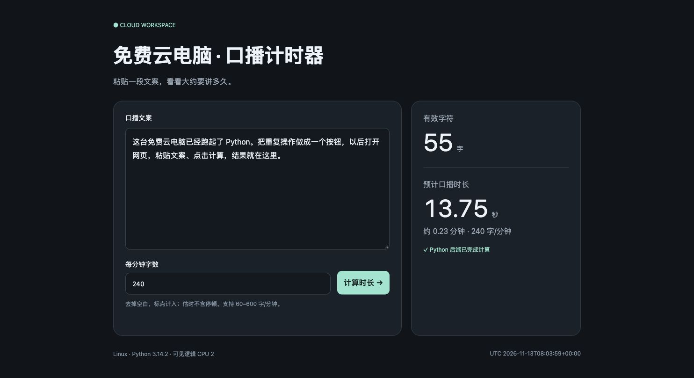

# Muse One Link · 大森的 Muse 进阶工具箱

**选一个案例，把链接发给 Muse，让它搭成你自己的工具。**

你负责说清想做什么；Muse 读取这里的执行说明，检查自己的云电脑，搭页面、接实际功能、用样例测试，最后给你能打开的入口。

## 从这里选

| 我想做什么 | 发给 Muse 的链接 | 做完应该拿到什么 |
| --- | --- | --- |
| 把短视频续接成长片，反复抽卡选版本 | [视频工作台](https://github.com/zysen1/muse-one-link/tree/main/cases/video) | 分镜、候选、选片记录及实际可播放的视频 |
| 找免费云环境，申请后部署自己的项目 | [免费云部署与工具箱](https://github.com/zysen1/muse-one-link/tree/main/cases/cloud) | 已核对的资源方案、可用工具入口及实际部署状态 |
| 少刷内容，先看解决当前问题的精选 | [今日精选](https://github.com/zysen1/muse-one-link/tree/main/cases/digest) | 有原链接和阅读依据的内容卡片、来源与反馈记录 |
| 改菜单就重算缺口，再核对购物车 | [晚餐补货](https://github.com/zysen1/muse-one-link/tree/main/cases/grocery) | 可保存的菜单、库存、补货清单和购物车核对结果 |

复制对应案例链接即可。想自定义，在后面加一句自己的需求，例如“做一个 30 秒的街边早餐短片”。如果 Muse 只总结了网页，再补一句：**“请按这个案例的执行说明直接搭建并测试，把可用入口给我。”**

## 新增：把免费云电脑真正跑起来

[打开完整案例：GitHub Codespaces + 口播计时器](cases/cloud/codespaces/README.md) · [可复制提示词](cases/cloud/codespaces/PROMPT.md)

把这个链接发给 Muse 即可开始：

```text
https://github.com/zysen1/muse-one-link/tree/main/cases/cloud/codespaces
请按里面的流程帮我申请或复用免费云电脑，部署并实际测试口播计时器，最后给我能打开的私有入口。
```

仓库包含真实截图、完整 Python 源码、启动/停止脚本和 Codespaces 启动配置。登录和免费额度由每个人自己的账号决定。本次样例由 Codex 在本机浏览器操作完成；Muse 仍需在你的环境里执行并验收。



## 这套用法的关键

把程序和记录放在 Muse 云电脑，构件作为操作面板。需要其他设备或其他人调用时，再接实际可达的入口与权限。外部免费云环境可作为部署扩展，先核对当时的免费条件。

这里提供的是**搭建说明、默认样例和验收标准**。工具由你的 Muse 在你的环境里创建；账号登录、视频额度、平台支持与外部网络入口以实际环境为准。视频生成按小样起步，购物车到核对为止。

## Muse / 其他接手的 AI：执行入口

用户发来的是某个案例链接时，读取该目录的 `README.md`，同时读取 [AGENTS.md](AGENTS.md) 和 [通用搭建流程](docs/BUILD.md)，然后开始实施。不要把案例页面仅当成需要总结的文章。

用户只给本仓库总链接时，先根据对话已有需求选择对应案例；没有线索就只问一次“视频 / 免费云部署 / 今日精选 / 晚餐补货，先做哪个？”。不要擅自同时运行四套任务。

- [全部入口与可复制消息](docs/LINKS.md)
- [结果怎么验收](docs/ACCEPTANCE.md)
- [视频 API 扩展：SenMuse](https://github.com/zysen1/senmuse)

## 维护

改动后运行 `python3 scripts/check_repo.py`，检查入口、相对链接、JSON 样例和敏感内容。欢迎复制和改造成自己的流程；原始文本与样例采用 [MIT License](LICENSE)。外部素材和项目仍按各自许可使用。
