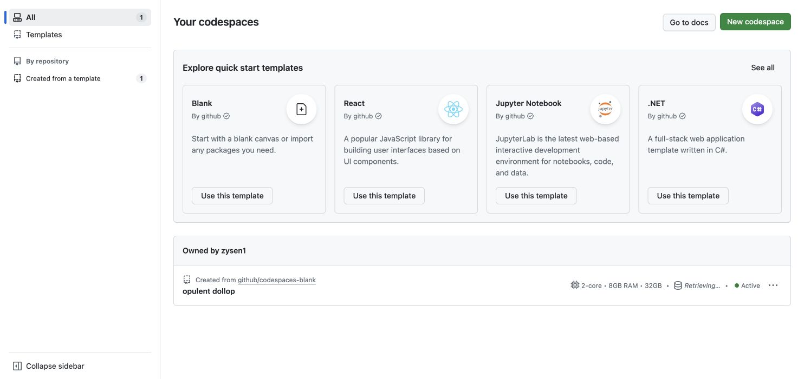
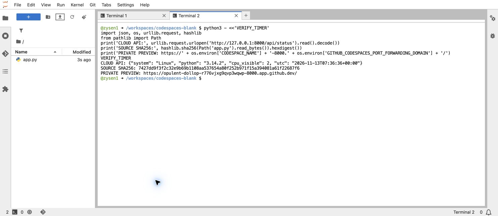
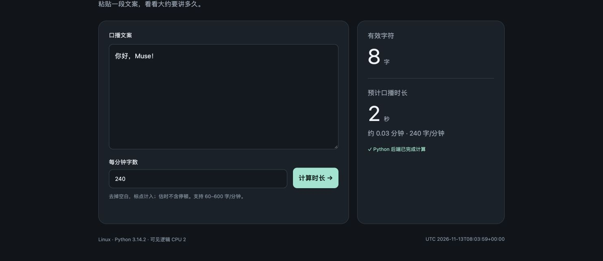
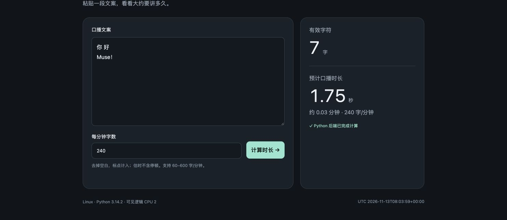
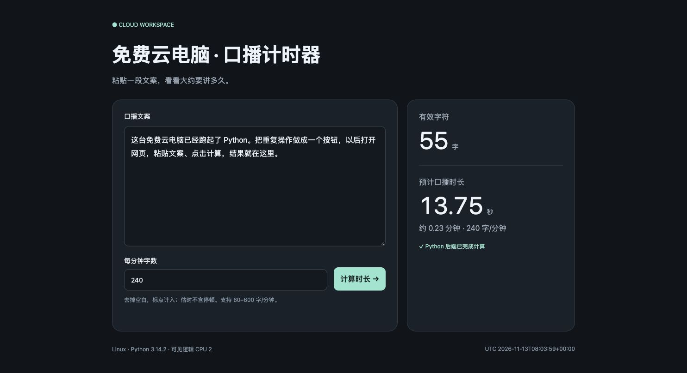
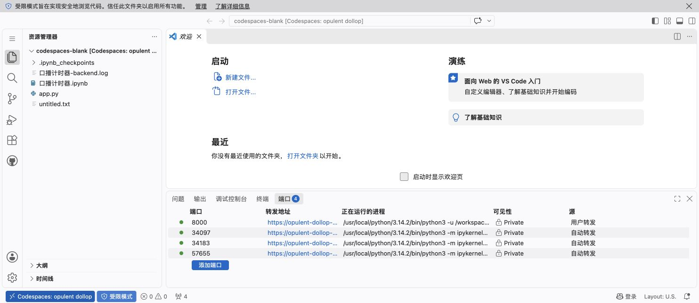

# 免费开发云电脑：口播计时器

把文案贴进网页，云端 Python 真正计算去空白后的字符数和预计口播时长。只用 Python 标准库，适合拿来学习部署自己的小工具。

**让 Muse 帮你搭：把本页或 [PROMPT.md](PROMPT.md) 的链接发给 Muse，再说“按这个案例帮我搭好并实际验收”。** 仍可能需要你登录 GitHub、完成验证，并拥有可用免费额度。

验证范围：`app.py` 已在已有 Codespaces 实例中通过云端 API 和私有网页测试。本仓库新增的自动启动配置与启动脚本完成的是本地检查，**尚未在全新 Codespace 上做端到端验收**；下面的一键入口是复刻入口，不是另一份新建机成功记录。

## 从这个仓库直接开始

先到 GitHub 的 Billing 页面确认本月计算与存储额度、超额预算，再打开下面的创建入口。已有合适的 Codespace 时优先复用；不要重复创建。

[](https://codespaces.new/zysen1/muse-one-link?quickstart=1)

1. 登录自己的 GitHub 账号，确认使用本仓库，选择可用的最小 **2 核**配置。遇到付费要求或免费额度不足时停在该步骤，不绑卡、不升级预算。
2. 创建后等待初始化。本仓库的 [devcontainer 配置](../../../.devcontainer/devcontainer.json) 选用 Python 3.12 镜像，配置为调用启动脚本并转发 `8000`；实际启动结果以日志和 API 检查为准。
3. 在 **Ports** 中确认 `8000` 的可见性是 **Private**，点击 **Open in Browser**。未自动出现时，手动添加端口 `8000`，保持 Private。
4. 按下文实际测试，确认后端和私有网页都可用。创建成功、启动成功、网页可访问是三项不同结果。

“一键入口”负责带你进入建机流程，不代表无需登录或保证所有账号、网络都能成功。私有预览需相应 GitHub 身份，不是发给任何人都能打开的公开网站。[官方入门](https://docs.github.com/en/codespaces/quickstart)、[端口转发说明](https://docs.github.com/en/codespaces/developing-in-a-codespace/forwarding-ports-in-your-codespace)。

## 在已有实例或 Blank 模板中使用

如果本仓库已在当前 Codespace 中，进入仓库根目录即可。若使用 [GitHub 官方 Blank 模板](https://github.com/github/codespaces-blank)，在终端克隆源码；已有同名目录先查看并复用，不覆盖旧文件。

```bash
git clone https://github.com/zysen1/muse-one-link.git
cd muse-one-link
python3 cases/cloud/codespaces/start.py start
```

仓库根目录下的管理命令：

```bash
python3 cases/cloud/codespaces/start.py status
python3 cases/cloud/codespaces/start.py start
python3 cases/cloud/codespaces/start.py stop
```

已有正常服务时使用 `status`，不要再手动启动第二份 `app.py`。主程序是 [app.py](app.py)，默认仅监听 `127.0.0.1:8000`，无需 `pip install`。在 Codespaces 外本机运行，只能证明本机成功。

## 确认它真的在云端工作

先在 **Codespace 的终端**查看实际环境：

```bash
python3 -c 'from urllib.request import build_opener, ProxyHandler; print(build_opener(ProxyHandler({})).open("http://127.0.0.1:8000/api/status").read().decode())'
```

接口返回 `system`、`python`、`cpu_visible` 和 `utc`，不返回主机名、IP 或令牌。应根据真实返回展示 Linux、Python 版本和可见逻辑 CPU，不能把示例数字写死。

然后打开 Private 8000 网页，语速均设为 **240 字/分钟**，分别粘贴并点击“计算时长”：

| 文案 | 有效字符 | 预计时长 |
| --- | ---: | ---: |
| `你好，Muse！` | 8 | 2 秒 |
| 下方两行，第一行中间有空格 | 7 | 1.75 秒 |

```text
你 好
Muse！
```

再换成自己的文案计算一次。`POST /api/analyze` 才负责计算；空格、换行等空白不计，标点计入。预计时长不含停顿，是按输入语速估算，不是语音合成或实际录音时长。

## 浏览器编辑器连不上时

先保留错误，检查实例状态与当前会话，不要反复新建机器。如果已有实例支持 JupyterLab，在 [Codespaces 控制台](https://github.com/codespaces) 的实例菜单选择 **Open in → JupyterLab**，尝试在其 Terminal 运行同一套命令。[官方打开已有实例的方法](https://docs.github.com/en/codespaces/developing-in-a-codespace/opening-an-existing-codespace?tool=webui)说明了该入口。GitHub 默认开发镜像包含 JupyterLab；**本仓库使用的 Python 3.12 镜像不保证预装它**，没有入口时按[官方连接排障](https://docs.github.com/en/codespaces/troubleshooting/troubleshooting-your-connection-to-github-codespaces)继续检查，不为主应用强装 Notebook 环境。

Jupyter 终端可用只证明能操作云端。主验收仍是 API 返回与 Private 8000 网页的真实按钮结果；没有打开网页就标为“外部预览待验证”。Notebook/widget 不是本案例的必需步骤，不为它额外安装依赖。

## 免费额度与停止方法

截至 2026-11-13，GitHub 个人 Free 计划官方列出每月 **120 核小时**与 **15 GB-month 存储**；2 核运行一小时消耗 2 核小时，因此计算额度约对应 60 小时。计划、资格、已有用量和规则可能变化，以你账号及[官方计费页](https://docs.github.com/en/billing/concepts/product-billing/github-codespaces)为准。

本配置采用自定义 Python 镜像，容器本身也会计入存储用量，实际用量请在 Billing 中核对。

这是有额度、可能休眠的开发云电脑，不是免费 24 小时 VPS。`start.py stop` 只停止这个应用；结束使用后，到 Codespaces 控制台选择 **Stop codespace** 才停止云电脑的计算用量。保留实例仍累计存储用量，删除也不会抹去本月已发生的累计使用量。[官方额度说明](https://docs.github.com/en/codespaces/troubleshooting/troubleshooting-included-usage)。

再次使用时恢复原实例，等待自动启动，再运行 `status` 检查；没有运行时执行 `start`。不再需要的实例应先保存必要文件，再决定是否删除。

## 真实结果截图

下列画面来自 **Codex 在用户本机浏览器中的实际操作**：应用在已有 Codespaces 上运行，私有网页完成了真实计算。旧实例的 Python 是 3.14.2，新模板配置为 3.12，不要求版本数字完全一致。它们不是“Muse 已自动申请”的证明；其他人的 Muse 仍需在各自账号与网络下完成上述验收。新增自动启动配置尚未做全新实例端到端验证，不能只凭旧截图判定成功。

| 云端运行 | API 返回 |
| --- | --- |
|  |  |

| 8 字、2 秒 | 去空白后 7 字、1.75 秒 |
| --- | --- |
|  |  |

| 完整工具 | 私有端口 |
| --- | --- |
|  |  |

## 给接手的 Muse / AI

先读 [AGENTS.md](../../../AGENTS.md)、[通用搭建流程](../../../docs/BUILD.md) 和本案例 [PROMPT.md](PROMPT.md)。在用户已授权范围内实际搭建和测试；交付用户自己的私有入口、源码位置、两次测试结果、停止与恢复方法。不要提交账号数据、私有实例链接、令牌或个人网络配置到这个公共仓库。
